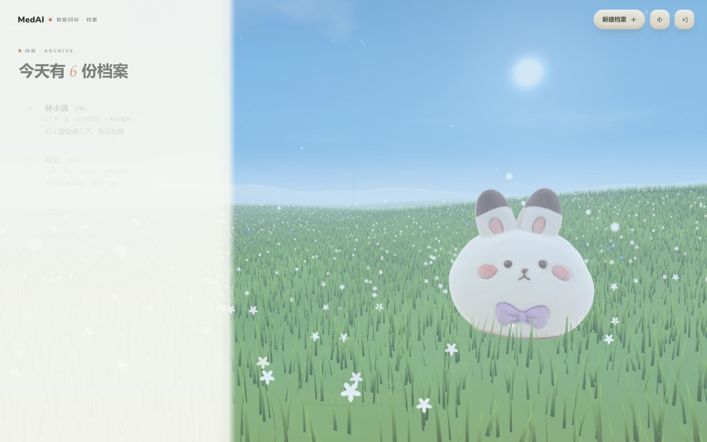

# MedAI — 草地上的绒球医生

> 给**家庭**用的 AI 健康档案与问诊工具。一个账号管全家人的档案，把「该吃什么药、该不该去医院、
> 复诊时怎么跟医生说」这三件最日常也最容易出错的事，放在一片能点开的草地上。

MedAI 面向真实需求：家里管药的那个人往往是二三十岁的子女，他要替父母记住药、替孩子判断要不要挂急诊、
还要在复诊时把三个月的病程复述给医生听。产品把这些信息收进一个容器，用 3D 草地作为入口 ——
家里每个人是一块小牌子，点开就能对话；天上吊着一块木板，写着全家今天吃了几次药，点一下就能打卡。

**边界写在明处**：不诊断、不开处方、不替用户判断「哪句话重要」。AI 只做翻译、整理和提醒。



## 团队信息

| 项目 | 内容 |
|---|---|
| 参赛院校 | 广东医科大学 |
| 参赛组别 | B 组（本科） |
| 团队成员 | 陈妍萱　【待补充】 |
| 指导教师 | 【待补充】 |
| 联系方式 | 【待补充】 |
| 参赛赛事 | 全国大学生计算机应用能力与数字素养大赛 · 第九届传智杯 · AI WEB 网页开发挑战赛 |
| 源码仓库 | <https://github.com/CC-Aira/MedAI>（Public，含完整提交历史） |

## 功能概览

| 模块 | 做了什么 |
|---|---|
| 家庭档案 | 一个账号多份档案：姓名、关系、生日、身高体重、过敏史、既往史、主诉、头像 |
| 用药与打卡 | 用药计划（药名 / 剂量 / 频次 / 起止）→ 今日待服 → 打卡与撤销；全家用药板一屏呈现 |
| AI 问诊 | DeepSeek 流式对话，结合档案与在服药物；高危症状由本地规则拦截并强制转诊 |
| 事实核对 | 模型只能提候选（补字段 / 加药 / 冲突），冲突项默认不勾选，必须患者确认才落库 |
| 科普库 | 90 条疾病（13 科室）+ 73 种药品（10 大类），含检查项目、常见误区、起效 / 漏服 / 储存 |
| 就诊材料 | 病程时间轴（可投影给医生看）+ A4 就诊摘要（可打印、可复制纯文本）+ 复诊日历 |
| 资料上传 | 化验单 / 处方照片 / PDF / Word，本地中文 OCR，可勾选作为对话上下文 |
| 兜底 | 中文 404 与运行时错误页；无 Key 时走本地模拟流，全链路仍可演示 |

## 技术架构

技术栈锁定：Next.js 16（App Router）+ React 19 + TypeScript 5 + Tailwind 4 + Prisma 6 + SQLite + DeepSeek。
认证只用 Node 内置 `crypto.scrypt` 与 HMAC 签名 Cookie，没有引入任何认证库。

### 分层结构

```
表现层   3D 草地（Three.js）· 档案栏 · 问诊面板 · 科普库
   ↓     同源 fetch，SSE 流式回传
接口层   23 个 Route Handler，统一入口守卫 requireUser()，查询强制带 ownerId
   ↓
领域层   红旗规则 · 提示词装配 · 事实核对 · 排程与依从性 · 摘要生成（全部纯函数或纯本地）
   ↓
AI 层    lib/ai.ts —— 模型调用的唯一出口，业务代码不直接 fetch
   ↓
数据层   Prisma 6 + SQLite（WAL）· 本地磁盘存附件 · schema.postgres.prisma 已备好
```

### 技术选型理由

| 层 | 选型 | 为什么 |
|---|---|---|
| 框架 | Next.js 16 App Router + React 19 + TS 5.9 | 同一仓库既有服务端取数也有客户端交互；Server Component 让档案在服务端就按 ownerId 过滤完，不下发整表 |
| 样式 | Tailwind 4 + 手写 CSS 变量 | 3D 转场、木牌投影需要精确时间轴与矩阵，纯原子类反而难写 |
| 3D | Three.js 0.170（自写 `engine.js`） | 草地是实例化渲染 + 顶点着色器风摆，通用编辑器做不出来也带不动 |
| 数据 | Prisma 6 + SQLite | 单机自用零运维；换 Postgres 只改 `DATABASE_URL` |
| 模型 | DeepSeek（OpenAI 兼容协议） | 中文问诊语境好、流式便宜；封装层不绑厂商，换模型只改环境变量 |
| 认证 | Node 内置 `crypto.scrypt` + HMAC Cookie | 不引认证库，少一个供应链风险；逻辑不到 200 行，可逐行审 |
| OCR | tesseract.js + 本地中文语言包 | 化验单不该上传到第三方识别服务；语言包随仓库走，断网可用 |

### 目录结构

```
src/
  app/
    page.tsx                     草地主页（服务端取自己的档案 → 交给客户端场景）
    login/                       登录 / 注册
    patients/new/                建档
    patients/[id]/               档案详情：用药 / 结论 / 问诊记录 / 时间轴 / 成长
    patients/[id]/edit/          编辑档案
    api/
      auth/{register,login,logout}
      patients, patients/[id]
      patients/[id]/{medications,consultations,notes}
      medications/[id], notes/[id], consultations/[id]
      consultations/[id]/{messages,summary,facts,sheet}
      growth, upload/avatar
  components/
    MeadowStage.tsx              开场蒲公英 + 3D 草地 + 档案栏 + 问诊面板（转场调度都在这）
    LoginForm.tsx  PatientForm.tsx  PatientDetail.tsx  SheetShell.tsx
    VisitSheet.tsx               就诊摘要那张纸（portal 到 body，打印时只留它）
    PatientTimeline.tsx          病程时间轴 + 投影视图（截图进 PPT 的那张）
    meadow/engine.js             Three.js 场景（纯 JS，配 engine.d.ts 给 TS 用）
  lib/
    auth.ts        scrypt 哈希 + HMAC 会话 + getCurrentUser / requireUser
    http.ts        HttpError、统一响应、错误收敛
    validate.ts    字段级校验（超长、空值、类型）
    ai.ts          DeepSeek 封装：流式 / 一次性 / parseJsonLoose / 演示模式
    medical-prompt.ts  个体化 System Prompt 装配（三个上限 + 合规三件套）
    facts.ts       diffFacts（代码判定冲突）+ applyFacts（重新校验后落库）
    consult-flow.ts     拼上下文、摘要、扫描候选、红旗落库、就诊摘要生成
    red-flags.ts   红旗症状的本地规则（11 条，纯正则，不调模型）
    visit-sheet.ts 就诊摘要的结构与清洗（纯函数）+ 本地模板 + 纯文本版
    patients/medications/consultations/notes/growth.ts  数据层与序列化
    medication-schedule.ts   排程与依从性（纯函数，漏服封顶 7 天）
    medication-board.ts      「今天的药」木牌数据：按档案聚合今天的进度
    timeline.ts      病程时间轴：把建档/用药/问诊/结论合成一条轴（纯函数）
  lib/client/      浏览器侧 fetch 封装与 DTO 类型
  data/            90 条疾病 + 73 种药品 + 科室定义 + 兔子语录
```

## 安装与运行

### 环境要求

- Node.js ≥ 20（开发用 22）
- 无需数据库服务：SQLite 单文件，首次运行自动建表
- 需要联网仅当调用 DeepSeek；断网时设 `MEDAI_DEMO_AI=1` 可完整演练

### 快速开始

```bash
npm ci
cp .env.example .env        # 填 DEEPSEEK_API_KEY、SESSION_SECRET
npx prisma generate         # 生成 Prisma Client
npm run db:push             # 建表，生成 prisma/dev.db
npm run db:seed             # 可选：写入演示账号与示例数据
npm start -- -p 3100        # 生产模式 http://localhost:3100
```

Windows 下双击根目录的 `Start MedAI.bat` 即可，首次运行会自动补齐上面四步（复制 `.env`、装依赖、
生成 client、建表）。

演示账号（跑过 `db:seed` 才有）：`demo@medai.local` / `Medai@2026`（另有 `other@medai.local` 同密码，
用来验证数据互不可见）。

### 环境变量

完整清单见 `.env.example`。

| 变量 | 说明 |
|---|---|
| `DATABASE_URL` | SQLite 文件路径，默认 `file:./dev.db` |
| `SESSION_SECRET` | 会话签名密钥，生产必须换随机长串（`openssl rand -hex 32`） |
| `DEEPSEEK_API_KEY` | 模型密钥，**只在服务端**，不进版本库 |
| `DEEPSEEK_BASE_URL` / `DEEPSEEK_MODEL` | 换厂商只需改这两项 |
| `MEDAI_DEMO_AI` | 设为 `1` 时走本地模拟流，无需 Key 也能演练全链路 |
| `MEDAI_DEMO_LOGIN` | 设为 `1` 时登录页出现「用演示账号直接进去」 |
| `MEDAI_CHAT_RETENTION_DAYS` | 对话原文保留天数，默认 30 |

`.env` 里 `MEDAI_DEMO_LOGIN=1` 时，登录页会多一个「用演示账号直接进去」的按钮 —— 现场演示不用敲密码，
也避不开限流（它走的就是正常的登录接口，密码错了照样 401）。正式环境留空即可。

### 常用命令

| 命令 | 作用 |
|---|---|
| `npm run typecheck` | `tsc --noEmit`，零错误 |
| `npm run lint` | eslint，零 error |
| `npm run build` | `prisma generate && next build` |
| `npm run test:api` | 接口自测（68 项），见 `docs/api-selfcheck.md` |
| `npm run db:backup` | 数据库一致性备份 → `backups/`，见 `docs/deploy.md` |
| `npm run pack` | 打离线分发包 → `dist/`，自动挡掉 `.env` / 数据库 / 上传文件 |
| `npm run pack:submission -- --team "学校+姓名+手机号"` | 打参赛提交包（源码 + 提交材料），见 `docs/submission/` |

## 核心设计

### 数据隔离

1. **归属只由服务端决定**：所有写入都用 `owner: { connect: { id: user.id } }`，请求体里的 `ownerId` 直接被忽略。
2. **越权用一条语句挡掉**：`findFirst({ where: { id, ownerId } })`。不做「先查再比对」—— 那会让攻击者
   从响应差异里确认某个 id 是否存在。别人的档案和真的不存在的档案，返回的都是同一个 404。
3. **接口顺序固定**：校验输入（400）→ 认门（404）→ 查配置（503）→ 干活。
4. **PATCH 只改请求里出现过的字段**：靠 `hasOwnProperty` 判断，没传的字段绝不会被擦成 `null`。
5. **写操作返回完整列表**：前端拿到就整体覆盖本地状态，不做增量拼装。

会话是无状态 HMAC 签名（7 天）。这意味着：登出会清掉浏览器里的 Cookie，但**旧 token 值本身在到期前
仍然可用** —— 要做到即时吊销得加黑名单表，本项目按规格选择了无状态。

### AI 设计

**个体化靠拼提示词，不做微调、不做向量库。** 每次对话前把四样东西拼成 System Prompt：

1. 档案（姓名 / 性别 / 年龄 / 体型 / 血型 / 体质 / 过敏史 / 病史 / 习惯 / 主诉）
2. 在服药物（`isActive` 的）
3. 最近 3 条问诊摘要
4. 星标优先的 8 条结论

token 靠三个上限恒定：历史 20 条、摘要 3 条、结论 8 条。医疗合规三件套永远在场：
不下诊断、不开处方；过敏史优先考虑并主动提醒；涉及处方药必须提示遵医嘱。

为什么不上向量 RAG：科普库是 90 + 73 条**结构化条目**，不是长文档。检索难点在别名与错别字
（「胃食管反流」与「烧心」、「甲亢」与「甲状腺功能亢进」），不在语义近似。用「归一化 + 同义词映射 +
多词 AND + 字段权重」命中更准、可解释、零依赖，也避免了为一个几百 MB 的 embedding 运行时
破坏「离线可部署」这条非功能需求。

**失败不留孤儿数据**：`POST /messages` 先调 AI，流读完且内容非空，才把用户消息和回复一起写进库。
Key 配错、上游 500、网络中断都不会攒出「只有提问没有回答」的记录。

**AI 提建议，患者点头**：`POST /facts` 只返回候选，一个字不写库；`PATCH /facts` 才落库。三类候选里，
`fill`（档案为空可补）和 `add`（新增用药）默认勾选；`conflict`（与档案不一致）默认**不**勾选并红色高亮，
必须患者亲手确认。冲突判定由代码 `diffFacts()` 完成，不交给模型。落库前每条都当不可信输入重新校验：
字段白名单、长度上限、单次 ≤20 条、`medicationId` 按 ownerId 重查一次。

**结论（Note）不许自动生成**：客观事实可以让 AI 整理，但「哪句重要」是价值判断，只有患者知道。

### 3D 场景与关键交互

- 开场是一株 186 颗种子的蒲公英（内联 SVG），吹散后 3D 场景才显出来。
- 3D 场景是 `engine.js`：程序化地形 + 6 万株实例草（顶点着色器里做风摆和踩踏衰减）+ 点精灵做的花与
  蒲公英 + 一只毛绒绒的绒球医生。眼神跟鼠标，鼠标静止 2.5 秒回来看你。
- 点开档案：球向右滚 90°、抬头、缩小；左栏左滑消失；问诊面板从右滑到中间。三者共用
  `--flow: 1100ms` 一条时间轴，同一刻停下，球正好趴在面板上边缘。
  - 球的落点不是写死的：用面板的 `offsetLeft/offsetTop` 反投影到 3D，换分辨率、换布局都准。
  - 转场进度用**墙钟**算，不累加 `dt` —— 低帧率设备上 `dt` 会被钳到 0.05，那样 1.1 秒会被拖成两三秒，
    球就和面板错开了。
- 移动端（≤860px）左栏变底部抽屉，球站在抽屉上边缘。
- **红旗症状不交给模型**：胸痛、呼吸困难、意识不清、大出血这类话一出现，本地规则当场中断问诊，
  画成红卡片而不是气泡，并把 `redflag.<kind>` 写进 `Message.flag` —— 刷新之后它还是红的。
  实测拦截 126ms，走模型 1646ms。见 `docs/red-flag.md`。
- **就诊摘要能带走**：一次问诊可以整理成一张纸（主诉 / 病程 / 在服药 + 过敏史 / 可以先做的 /
  何时必须就医 / 想问医生），支持打印存 PDF、复制文字。纸面的字号和布局是单独重排的
  （A4 单页、不依赖 flex、色块用真边框，哪个工具转 PDF 都不容易变形），复制出去的纯文本
  同样带过敏史和既往病史。模型挂了或没配 Key 就退回本地模板，绝不空手。见 `docs/visit-sheet.md`。
- **关掉档案再打开，话还在**：打开时接着这个档案最近一次没归档、真的聊过的问诊继续，
  点「这次聊完了」才归档、下次重新开始。空问诊不进问诊记录列表，关面板时也会顺手删掉。
  见 `docs/consult-session.md`。
- **问诊记录是日历**：聊过的那天点一个小圆点（一天聊了两次就是两个点），点日期看当天的记录，
  再点「看聊天记录」读原文。对话只留 30 天，超期之后不假装还有原文 —— 直接读当时留下的
  小结，没留就照实说。见 `docs/visit-calendar.md`。
- 左上那片天上吊着一块**小木板**（两根铁链挂着），写全家今天吃了几次药（只统计设了用药跟踪的档案）。
  桌面是一块真的 3D 木板：锯口不齐的长条板 + 两根铁链吊着，微风吹着轻轻摆；木纹是代码现场算的
  四张贴图（颜色 / 法线 / 粗糙度 / 端面），高度场求导得法线，每圈年轮的粗细和深浅各自随机，
  端面另有横切的年轮弧；板子背后有太阳，所以单独给它补一盏只照板子的侧光；板面那层字是 HTML，
  每帧用单应矩阵贴到板子四角上，所以是真字体、缩放不糊。**点一下木牌**，卡片从板子下面长出来，
  每位家人一段、每颗药一行；**行本身就是打卡按钮**，点一下记为已服、再点一下撤销 —— 不用进档案页，
  打完三处同时变（行内状态、表头 2/5→3/5、板面上的字）。一个跟踪都没有时它**不会消失**，
  而是挂一块写着「今天还没有要吃的药」的空板子 —— 点开告诉你怎么用，功能才找得到。
  手机上换成档案栏顶上的一条（那块天放不下一块看得清的吊牌）。见 `docs/medication-sign.md`。
- **病程时间轴**：档案页第五个 tab，把建档 / 用药 / 问诊 / 结论排到同一条纵轴上，
  按「真发生时间」归日（用药看 `startDate`、问诊看 `lastMessageAt`，不看会被归档刷新的 `updatedAt`）。
  右上角「投影视图」铺一张 880px 白纸，内容超一屏可以点「缩到一屏」，截一张图直接进 PPT；
  Ctrl+P 也能存 PDF。见 `docs/timeline.md`。
- **疾病科普 / 药品说明**：左栏顶上两个独立入口。**90 条**常见病（13 个科室全覆盖）+ **73 种**
  常用药（10 个药理大类），都按科室和大类浏览、也能直接搜症状 ——「拉肚子」「痘痘」「血压高吃什么药」
  都能命中（同义词归一 + 字段权重，纯函数跑在客户端）。疾病详情八节，其中
  **「去医院一般会做哪些检查」**和**「流传很广，但不对」**是最实用、别处又常讲不清的两节；
  药品详情除了六项正文，另有**起效 / 漏服 / 储存**三张卡。每条都带指南来源和整理月份，
  底部固定一句「科普不替代面诊」。列表和详情头都有插图：`DeptArt.tsx` 里 18 组自绘 SVG 线稿，
  矢量不糊、无图片版权问题。见 `docs/health-library.md`。
- **到点提醒先找兔子，再找系统**：开着提醒时，到点由兔子在草地上说一句、蹦一下，
  同时（有权限才）弹系统通知。不开通知权限也照样提醒 —— 以前只有系统通知这条通道，
  权限一拒整个功能就废了。人不在草地上的时候那句话会存着，回来再补上。

### 数据库

SQLite 单文件，`prisma/dev.db`。`src/lib/db.ts` 在装配时做了两件容易被忽略的事：

- **连接池压到 1 条**（`connection_limit=1`）—— SQLite 写入本来就是整库串行，连接开多了只会更容易撞
  `SQLITE_BUSY`（全家几台手机同时打卡就是这种场景）；
- **切 WAL** + `busy_timeout=5000` + `synchronous=NORMAL` —— 默认模式下一个写事务锁住整库、读只能等，
  WAL 下读走自己的快照。

两者都只在 `DATABASE_URL` 以 `file:` 开头时生效，换 Postgres 自动跳过。因为开了 WAL，**备份不能用 `cp`**，
用 `npm run db:backup`（走 `VACUUM INTO`）。细节见 `docs/deploy.md`。

### 兜底与降级

- **走错路也有出口**：`not-found.tsx` / `error.tsx` 是中文奶油色面板 —— 默认的 Next 404 是英文
  「This page could not be found」，既不像产品也没有回头路；现在写清楚「怎么了」，并给「回到草地 / 再试一次」。
  错误详情只进控制台和 `digest`，不摊给用户。
- **没有 Key 也能演**：`MEDAI_DEMO_AI=1` 走本地模拟流，协议与真实调用一致。
- **模型挂了有本地模板**：就诊摘要、结论卡片都有纯本地生成路径。

## 测试

项目没有引入测试框架，但有 5 套可重复执行的自检脚本，每次改动后跑一遍，输出通过 / 失败计数：

| 脚本 | 项数 | 覆盖什么 |
|---|---|---|
| `scripts/api-test.ts` | 68 | 注册登录、越权、档案 CRUD、用药、问诊、事实核对、附件 |
| `scripts/check-board.mjs` | 33 | 木牌位置、卡片明细、打卡与撤销、三处同步、resize 回归、移动端 |
| `scripts/check-reminder.mjs` | 20 | 提醒时间计算、免打扰、漏服封顶、文案 |
| `scripts/check-login.mjs` | 18 | 登录只有邮箱一条路、Cookie、越权拒绝 |
| `scripts/check-entry.mjs` | 8 | 中文 404、错误页出口、演示入口一步进入 |

另有 `tsc --noEmit` 与 `eslint .` 保持零错误。

## 部署

| 方式 | 适用场景 | 要点 |
|---|---|---|
| 本机直跑 | 演示、答辩现场 | `Start MedAI.bat` 或 `npm run build && npm start -- -p 3100` |
| Docker | 交付机构、社区医院 | `docker compose up -d`，多阶段构建只留 standalone 产物 |
| Caddy 反代 | 公网在线演示 | Caddy 管 HTTPS 与反代，容器只监听内网端口 |
| 离线包 | 网络受限环境 | 47MB 离线包解压即跑，无第三方 CDN 依赖 |

详见 `docs/deploy.md`。

## 已知取舍

- **会话无状态**，登出不吊销 token（见上）。
- **头像存本地磁盘** `public/uploads/avatars/`，多实例部署需换对象存储。
- **SQLite** 单文件，适合单机自用；并发写多了要换 Postgres。答辩演示**不建议**临时换库，
  三条路线的取舍和 Dockerfile 都在 `docs/deploy.md`，Postgres 版 schema 也已经备好。
- **限流是进程内的**，起多实例必须换 Redis。
- **只校验文件头魔数**（PNG / JPEG / GIF / WebP），没有做图片解码与重编码；文件名由服务器用
  `randomUUID` 生成，不采信用户文件名。
- **首屏 3D 模型 4.7MB**，弱网下兔子会晚出现一两秒，有程序化占位体兜底，不会白屏。

## 文档索引

- `docs/submission/技术文档.pdf` —— 参赛技术文档（22 页，按官方七段式组织）
- `docs/submission/演示视频脚本.md` —— 演示视频分镜与旁白
- `docs/deploy.md` —— 三条部署路线、备份与恢复
- `docs/red-flag.md` —— 11 条红旗规则的设计与边界
- `docs/medication-sign.md` —— 3D 木牌的建模、投影与打卡交互
- `docs/visit-sheet.md` —— 就诊摘要的版式与降级策略
- `docs/health-library.md` —— 科普库的内容来源与检索策略
- 其余模块设计笔记见 `docs/` 目录
